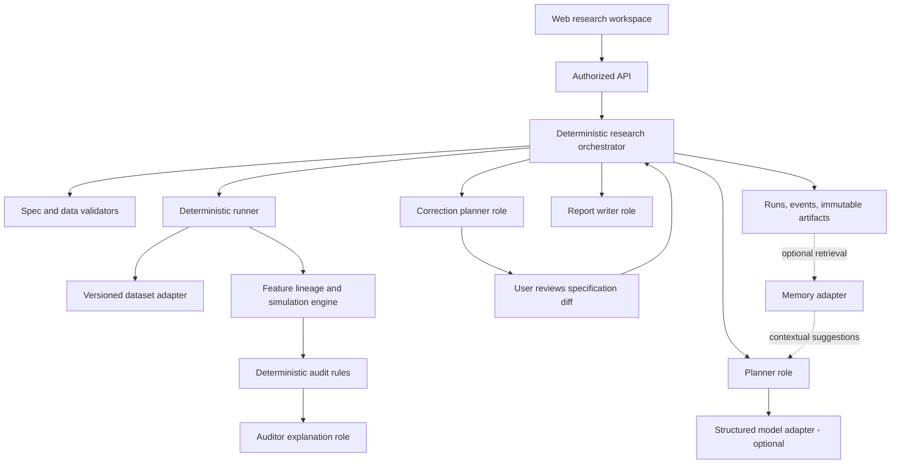
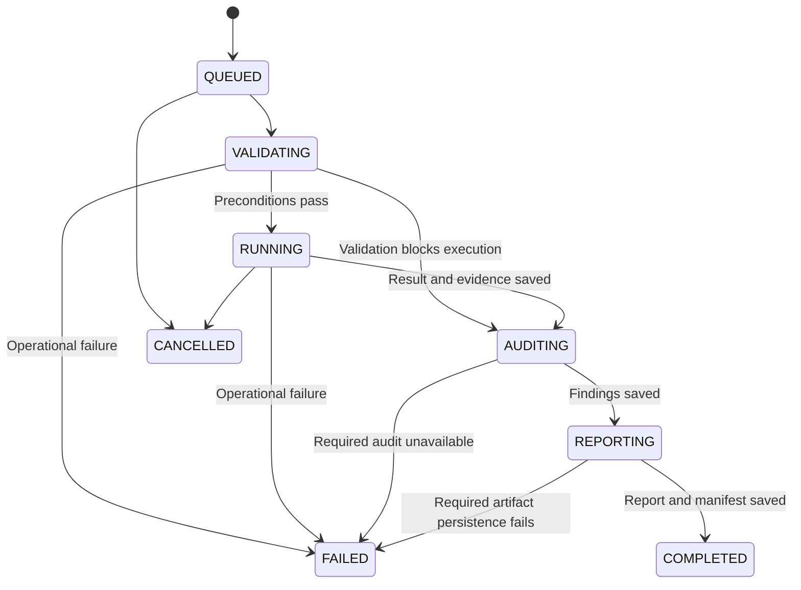

# QuantForge Architecture

Design version: 0.1 | October 24, 2026 | Status: target architecture; foundation partially implemented

Implementation note: see [Implementation status](IMPLEMENTATION.md) for the shipped subset and deliberate deviations. The complete design below remains a target, not a claim that every capability is present.

## 1. Design intent and decisions

The source is the team's revised QuantForge whitepaper, especially sections 3-9 and Appendix A. This document turns those proposals into an implementation-oriented design. Choices that extend the whitepaper are explicitly recorded below.

The core outcome is an inspectable research experiment, including an explanation of why its result may be unreliable. Profitability is not the acceptance criterion.

### Decisions added to resolve ambiguity

| Decision | Proposed default | Reason |
| --- | --- | --- |
| Agent topology | One deterministic coordinator and bounded specialist roles | Easier to debug and evaluate than an unconstrained agent conversation |
| Execution unit | Single-symbol daily open-to-close trade | Keeps position and timing semantics testable |
| Availability checks | Check both decision time and execution time | An input can predate a fill yet still be unavailable when the decision was made |
| Invalid demonstration | Separate privileged diagnostic fixture path | Demonstrates a bad result without weakening normal execution |
| Costs | Simple return deduction with an explicit formula and version | Matches the whitepaper's approximate model; avoids double-counting slippage |
| Allocation | 100% of prior end-of-session NAV, fractional notional, no leverage | Removes unspoken position-sizing behavior |
| Missing market data | Reject malformed rows; skip explicitly non-tradable sessions | No invented prices or calendar interpolation |
| Corrections | User-approved immutable child runs | Preserves economic intent, provenance, and original evidence |
| Initial storage | SQLite metadata plus content-addressed artifact files | Sufficient for a small MVP; no memory platform dependency |
| Numerical precision | Full internal precision; round only for display | Prevents display formatting from changing outcomes |

These are a coherent proposed baseline, not user-confirmed financial assumptions or claims about a deployed product.

## 2. System shape

The browser renders stored outputs and requests actions. The API resolves identity and ownership. The coordinator controls execution order. Agents do not call one another in an open-ended loop.

The numerical engine has no LLM dependency. The template path must produce a valid StrategySpec and run the full workflow without an API key.

For the first implementation, the runner can execute as a bounded background worker in the backend deployment. A durable queue is a later operational improvement; requests must never depend on holding a browser connection open.

## 3. Agent and service contracts

### 3.1 Research Orchestrator

**Type:** deterministic application service, not an LLM.

**Inputs:** authenticated or demo workspace context, plan/run identifiers, approved specification revision, dataset snapshot reference, action request, and idempotency key.

**Responsibilities:**

- Resolve ownership before loading artifacts or allocating a job.
- Validate the requested state transition.
- Freeze the approved plan, specification hash, dataset hash, and execution versions.
- Dispatch only approved tools in the fixed pipeline.
- Persist events and artifacts before publishing completion.
- Apply time, input-size, concurrency, model-call, and artifact quotas.
- Preserve the parent run on failure or cancellation.

**Outputs:** state transitions, run references, progress events, or a typed failure.

**Forbidden:** changing assumptions, modifying audit verdicts, silently substituting data, or reporting a job as completed before persistence succeeds.

### 3.2 Planner

**Type:** optional LLM role with deterministic template fallback.

**Input packet:** user hypothesis; supported strategy catalog; schema version; dataset manifest summary; user-confirmed preferences; optional memory citations.

**Output packet:** proposed StrategySpec; field-level source labels (user, template, default, memory suggestion); assumptions; unresolved questions; unsupported requests; and a plain-English plan summary.

**Process:** classify scope, extract parameters, map them to supported fields, apply visible defaults, then submit to schema and semantic validation. The server, not the model, determines validity.

The MVP permits one structured generation and one schema-repair attempt. If both fail, offer the template editor. Ambiguous entry/exit timing or an unsupported asset model must be resolved before approval. A failed model request must never silently become a different hypothesis.

**Forbidden:** Python generation/execution, price retrieval outside the registered dataset adapter, invented datasets, fabricated metrics, or approval of its own plan.

### 3.3 Runner

**Type:** deterministic service. The UI may call it an agent step, but there is no benefit to an LLM deciding arithmetic.

**Inputs:** frozen StrategySpec, dataset snapshot, execution mode, and run identifiers.

**Responsibilities:** load the pinned snapshot, validate data, calculate features and lineage, validate information timing, generate orders, simulate fills, apply costs, calculate NAV/metrics, and write execution evidence.

**Outputs:** BacktestResult, feature dependencies, order/fill records, skip reasons, environment manifest, and artifact hashes.

**Forbidden:** repairing invalid data without a recorded transformation, relaxing timing checks, reading the latest mutable dataset instead of the pinned one, or using model text as a computed result.

### 3.4 Auditor

**Type:** deterministic rule engine plus optional LLM explanation.

**Inputs:** specification, dataset validation report, feature lineage, decisions/orders/fills, cost configuration, execution mode, and stored result.

**Outputs:** versioned AuditFindings and coverage summary. The explanation role may add narrative linked to finding IDs.

Each rule owns its status, severity, evidence references, and effect on admissibility. The explanation model receives these as immutable facts. A machine finding remains available even if explanatory text generation fails.

**Independence:** rules are separate from simulation logic and re-evaluate recorded dependencies rather than trusting an engine flag saying "valid." This is separation of responsibilities within one product, not third-party assurance.

**Forbidden:** declaring a check passed without required evidence, inferring absence of overfitting from a high Sharpe ratio, or changing a deterministic failure into a warning.

### 3.5 Correction Planner

**Type:** deterministic correction templates first; optional LLM explanation or selection among allowed patches.

**Inputs:** selected findings, frozen original specification, allowed correction operations, original user intent, and dataset capabilities.

**Outputs:** CorrectionProposal with finding references, before/after fields, rationale, comparability assessment, remaining limitations, and expected check changes. Expected performance direction is never asserted.

Examples:

- Replace an impermissible future-close reference with an approved trailing feature at session t.
- Add a user-editable nonzero fee/slippage assumption for a sensitivity experiment.
- Recommend another dataset after A03; never invent a missing open.

A correction that changes the feature horizon or signal definition changes economic meaning. Explain this explicitly. All MVP reruns require user review of the proposed diff. A correction cannot broaden into automatic parameter optimization.

**Forbidden:** mutating parent artifacts, rerunning without approval, altering hashes to hide a change, or repairing returns directly.

### 3.6 Report Writer

**Type:** deterministic report template with optional LLM prose.

**Inputs:** saved run references, metrics, finding IDs, dataset manifest, assumptions, correction diff, comparison classification, and failure states.

**Outputs:** versioned report artifact with traceable metric references and limitations.

Numeric tables and chart series are rendered directly from engine artifacts. Generated prose is checked for unsupported numeric claims; if it fails validation, use the deterministic report. Missing results are rendered as unavailable, not as zero.

**Forbidden:** claiming statistical significance, investment suitability, generalization, or integration success without the corresponding evidence.

### 3.7 Memory Adapter (P1)

Store concise user-confirmed preferences, specific prior findings, and accepted corrections, with provenance and expiry/revocation metadata. Retrieval is scoped to the current workspace and compatible strategy family.

A preference such as "usually use 5 bps commission" is a suggested default, never a hidden override. Display the source run and ask the user to review the resulting plan. Prompt text embedded in prior reports remains untrusted.

P0 stores runs for reproducibility but does not claim cross-run agent memory. SurrealDB is optional and requires a genuine observable retrieval-to-plan effect.

## 4. Workflow and state

Separate plan state from run state so that user interaction does not mutate a completed experiment.

### Plan state

DRAFT -> VALIDATING -> NEEDS_INPUT or READY_FOR_REVIEW -> APPROVED.

Any edit to a reviewed plan produces a new revision and invalidates the previous approval. Approval binds the exact revision and specification hash.

### Run state

COMPLETED describes workflow completion, not research validity. A completed blocked run can contain an A03 finding and no backtest result. An operational failure is FAILED with a stage and error code.

Admissibility is a separate field:

- **ADMISSIBLE_WITHIN_CHECKED_SCOPE:** executed with all mandatory checks passing; warnings and unverified optional checks remain visible.
- **BLOCKED:** required conditions fail or an audit establishes invalid methodology.
- **UNVERIFIED:** mandatory evidence is incomplete; no claim of checked validity.

CorrectionProposal has its own lifecycle: PROPOSED -> APPROVED -> CHILD_QUEUED, or REJECTED / STALE. Approval is atomic with checking the parent, revision, and workspace ownership. The child references parent_run_id and correction_id.

Cancellation after a result has been atomically committed does not retroactively cancel that result. Record the action outcome and show the persisted state.

## 5. Temporal semantics

A row's date is a session label, not a timestamp. Dataset metadata identifies the exchange timezone and calendar. Event timestamps are timezone-aware, normalized to UTC, and include ordering for events at the same boundary.

For a feature, record source row IDs, source fields, availability times, transformations, and the feature's maximum availability time. Do not derive availability merely from a row's date.

For the supported strategy:

- Return signal: close(t) / close(t-L) - 1.
- Warmup requires L prior sessions and a positive denominator.
- The decision occurs after the session-t close data is available.
- The order is submitted after that decision.
- Entry occurs at the next tradable session's open.
- Exit occurs at that entry session's close.
- No forward return is used to decide entry.

Mandatory ordering is: all input availability <= decision time <= order submission time < entry fill time. An explicit event-order convention resolves equality at publication/decision boundaries. Input availability must also be strictly before entry fill.

A01 checks both future-bar references and these temporal relations. Comparing only feature availability with fill time is insufficient: data could become available after the decision but before the fill.

A future close used before the open fails regardless of how profitable the resulting curve appears. The engine records dependencies for inactive decisions as well as executed trades, since future data can also influence the decision to remain flat.

Calendar gaps do not create synthetic sessions. The final session has no next-session entry opportunity and creates no trade. Incomplete feature history creates a warmup skip; it is not converted into a zero signal.

## 6. Data and numerical model

### 6.1 Dataset contract

Required fields: date, symbol, open, high, low, close, volume.

Validation rejects absent columns, duplicate symbol/session keys, nonfinite or nonpositive prices, negative/nonfinite volume, nonmonotonic per-symbol dates, inconsistent OHLC relationships, unsupported mixed currencies, and missing required values.

Require low <= open/close <= high and low <= high. Preserve original row numbers in errors. Duplicate rows are rejected rather than silently removed. An optional explicit ingestion transform may later deduplicate into a new version with a transformation log.

The initial fixtures are synthetic, one symbol, one currency, no corporate actions. Historical inputs require a consistent OHLC adjustment basis; unknown or mixed adjustment policy blocks the supported execution model. Historical universe completeness remains outside MVP coverage.

Zero volume and explicit suspension flags produce non-tradable sessions. Missing required prices are data errors, not trade skips. Without liquidity metadata, the engine cannot establish real fill feasibility and the report must say so.

### 6.2 Portfolio assumptions

One long trade at most per entry session, no simultaneous positions, no overnight carry, fractional notional, no leverage, no shorting, no cash interest, no tax, and no dividends in synthetic fixtures.

Allocation a is fixed in (0, 1], default 1. Starting NAV defaults to 10,000 currency units and is visible in plan review. Unallocated cash is unchanged.

### 6.3 Costs and returns

Use the whitepaper's approximate proportional return model as version simple_return_deduction_v1:

- gross trade return = close(entry_session) / open(entry_session) - 1.
- round-trip cost fraction c = 2 * (fee_bps_each_side + slippage_bps_each_side) / 10,000.
- net trade return = gross trade return - c.
- session portfolio return = a * net trade return when a trade occurs, otherwise 0.
- NAV(session) = prior NAV * (1 + session portfolio return).

Fee and slippage components are charged against entry allocated notional. This is a simplified accounting convention, not a full broker cash ledger. Do not also shift fill prices for slippage under this model, which would charge slippage twice.

If costs produce nonpositive NAV, stop with a controlled model-domain failure. Do not clip returns or quietly continue.

### 6.4 Metrics

Compute total return from ending and starting NAV. Maximum drawdown is the most negative NAV / running peak - 1, including starting NAV in the peak history. Include flat sessions.

Show trade count, sample dates, observation count, and exposure alongside returns. Define turnover as total modeled entry-plus-exit notional divided by initial NAV; label this convention and avoid implying it is an annualized standard.

Sharpe is optional P1. If added, use all session returns, disclose zero risk-free-rate assumption and annualization factor, and return N/A for insufficient observations or zero variance.

Keep raw values in artifacts; round only presentation values. Hash canonical unrounded artifacts using a documented serialization and numerical-environment version.

## 7. Audit rules and evidence

| Rule | Evaluation | Outcome and UI |
| --- | --- | --- |
| A01_LOOKAHEAD | Independently examine source dependencies against decision, order, and fill events | Fail/high blocks admissibility; show offending field, row, session, and ordered timestamps |
| A02_MISSING_COSTS | Inspect fee/slippage completeness; if trades exist and total modeled cost is zero, warn | Undefined costs fail plan validation; explicitly approved zero costs are allowed with warning |
| A03_DATA_INTEGRITY | Run before simulation; inspect schema, keys, ranges, timestamps, OHLC consistency, and adjustment policy | Fail/high blocks simulation; show row-level evidence and remediation path |
| A04_SPLIT_LEAKAGE | P1 only with declared splits and parameter provenance | Unverified in P0 |
| A05_OVERFITTING_RISK | P1 inspect trial history and holdout use | Warning or Unverified; never conclude absence of overfitting |
| A06_SURVIVORSHIP | Require point-in-time universe and delisting metadata | Unverified in MVP |

Statuses: PASS, WARN, FAIL, UNVERIFIED, NOT_APPLICABLE. Severity is a separate enum: INFO, LOW, MEDIUM, HIGH. Execution effect is NONE or BLOCK. NOT_APPLICABLE requires a reason, such as no simulated trades for cost impact; it is not counted as passed.

Every finding includes rule/version, scope, evidence references, explanation, suggested action, limitations, and rerun requirement. Aggregation preserves each rule rather than producing a misleading confidence percentage.

### Diagnostic mode

Normal requests cannot set diagnostic mode or select arbitrary leaky expressions. The server exposes only fixed, approved synthetic fixture IDs through a separate demo action. The coordinator stamps execution_mode=DIAGNOSTIC_INVALID and a permanent warning.

For diagnostic runs, A03 still blocks malformed data. A01 violations are deliberately recorded and allowed to reach numerical simulation for demonstration, then reported as FAIL with admissibility BLOCKED. This narrowly scoped exception is not available for uploaded data or normal plans.

The corrected child returns to RESEARCH mode and must pass the normal gate. A future-price column alone is not a leak: the evidence must establish that it influenced a decision.

## 8. Correction and comparison

A correction is a validated patch to a StrategySpec or a new dataset reference, never a patch to a result curve.

The comparison service classifies the relationship:

- **CONTROLLED_ASSUMPTION_CHANGE:** same dataset, sample, signal, and execution model; costs/allocation changed.
- **METHODOLOGY_CORRECTION:** signal dependency or decision timing changed; outcome is a correction, not an apples-to-apples attribution of alpha.
- **NOT_DIRECTLY_COMPARABLE:** sample, dataset, symbol, or engine semantics differ materially.

Show the diff, classification, both audit states, both run IDs, and the common sample. Do not silently trim or rescale series. If an aligned overlay is offered, retain originals and label alignment.

A02 sensitivity uses identical signals and gross fills, differing only in cost parameters. It is its own child experiment, and any before/after claim waits for that child's result. A03 repair generally requires a new dataset snapshot and cannot be portrayed as a timing-only fix.

If a rerun fails, keep the parent view and show the failed child separately. Never label the old curve as corrected.

## 9. Persistence, reproducibility, and observability

Store datasets/manifests, approved plans, immutable runs, child lineage, results, findings, correction approvals, reports, and append-only run events.

Artifact identity includes dataset byte hash, normalized-data hash, canonical specification hash, engine/rule/schema versions, code commit, dependency-lock hash, calendar version, seed where relevant, and execution mode.

Persist trade/result artifacts atomically before advancing to AUDITING. Persist findings before REPORTING. Completion requires a retrievable manifest. A storage failure yields FAILED with partial artifact references for investigation.

Resume from the last committed stage. A worker lease prevents concurrent processing; retries reuse stage idempotency keys. An engine stage interrupted before commit may restart from frozen inputs. Never append duplicate trades to a partial result.

The numerical replay promise covers the deterministic engine with pinned inputs and environment. Re-running an LLM prompt is not promised to reproduce its text; the accepted StrategySpec and generated narratives are saved.

Record per-stage duration, tool outcome, model usage, retries, evidence counts, and safe error codes. Operational logs redact secrets and avoid raw private prompts by default.

## 10. Security and resource boundaries

Models receive narrow context packets and can propose only allowlisted typed operations. No arbitrary shell, downloaded Python, unrestricted URLs, or general file access.

Every API/tool invocation resolves workspace membership and run ownership server-side; request user_id values are not trusted. Artifact download URLs are scoped and short-lived. Comparisons require access to both runs.

Anonymous demo sessions receive isolated ephemeral workspaces and only approved fixtures. They cannot enumerate saved user runs or modify shared source datasets.

Treat hypotheses, CSV headers, provenance text, model output, memory, and imported reports as data. They cannot grant permissions or redefine tool rules. Avoid sending raw market rows to the model when summary metadata and bounded evidence suffice.

Proposed initial quotas: 1 symbol, 10,000 rows, 5 MB CSV, 4,000-character hypothesis, 1 active run per workspace, 60 seconds per engine stage, 20 seconds per model call, 3 model calls per workflow, and no automatic correction loop. Values are starting constraints to benchmark, not measured capacity. Enforce model output-token caps through the selected provider adapter and record actual usage.

Retry at most twice for clearly transient infrastructure failures with backoff. Do not retry invalid input, authorization failures, or audit failures as if they were transport errors. Require an idempotency key before retrying a mutation.

## 11. User experience

The workspace has five primary views: Research Home, Plan Review, Results, Audit Workspace, and Compare/Report.

Plan Review exposes every default and the exact decision/entry/exit timeline. Results lead with admissibility and dataset label, followed by NAV and sample statistics. Audit cards show what happened, concrete evidence, consequence, and proposed action.

Use distinct UI states for queued, validating, running, auditing, reporting, failed, cancelled, and completed-but-blocked. A03 failure shows no fabricated empty chart. A missing metric is N/A. Model timeout offers templates and factual rule text.

Diagnostic runs carry a persistent invalid/synthetic banner in results, comparison, and exported reports. Optional checks display coverage and unknowns. No single "reliability score" replaces the checks.

## 12. Delivery boundary

P0 delivers templates, synthetic fixtures, deterministic engine, A01-A03, evidence, correction review, immutable reruns, comparison, and web integration.

P1 adds natural-language planning, authenticated persistence, downloadable reports, measured usability, holdout-aware checks, and genuine cross-run memory.

P2 considers multi-asset portfolios, additional strategy families, richer execution models, research CI, and optional cross-system agent evaluation.

No broker integration, live execution, profitability forecasting, unbounded code generation, or automatic strategy optimization is in scope.

See [Contracts and delivery](CONTRACTS_AND_DELIVERY.md) for implementation handoff and verification.
