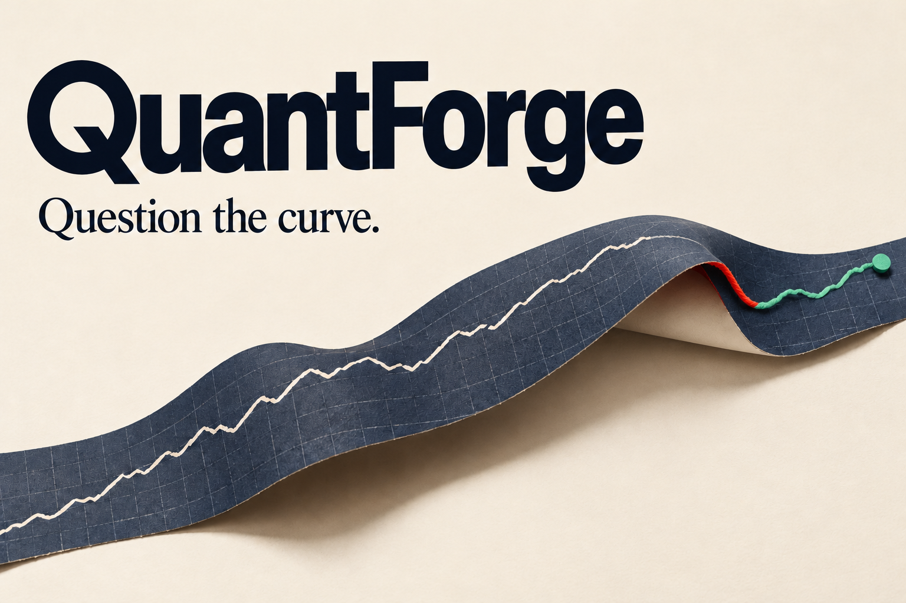

# QuantForge submission artwork

The selected project cover is [quantforge-devpost-cover-v3.png](quantforge-devpost-cover-v3.png). It uses warm ivory, midnight navy, vermilion, and mint green, with a smooth paper curl revealing the underlying trace.

- Format: PNG, 1536 × 1024 pixels (3:2), approximately 2 MB.
- Intended use: Devpost project thumbnail, project gallery, and repository introduction.
- The artwork is conceptual, rather than a screenshot or a plot of measured results. Use the [actual comparison screenshot](../screenshots/comparison-v2-desktop.png) alongside it when presenting the working application.
- Created with the built-in imagegen tool. The final [edit prompt](quantforge-devpost-cover-v3.prompt.txt) is included for provenance.

The cover is linked from the main project README. Uploading it to Devpost is a separate page-editing step.
